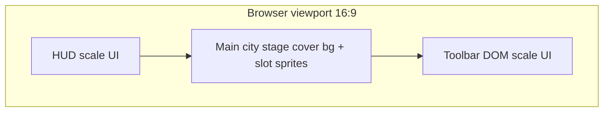

# PC 横屏布局草图（DRAFT）

## 设计基线

| 概念 | 尺寸 | 说明 |
|---|---|---|
| **设计基线（layout design size）** | **1600 × 900** | 布局、槽位坐标、HUD 边距均在此坐标系下标注（逻辑 px）。 |
| **最小内容视口（min content viewport）** | **1280 × 720** | 16:9；低于此宽度时优先保证主城舞台可读，两侧可裁切或加 letterbox。 |
| **当前客户端画布（legacy / status only）** | 360 × 640，DOM `max-width: 480px` | **非**美术验收基线；仅记录 `client/index.html` 现状，横屏改造完成前仍可能以此开发。 |

未调整上述数字：1600×900 覆盖常见 1080p 窗口内嵌游戏区；1280×720 与 16:9 最小桌面窗口一致。

## 区域划分（设计坐标 1600×900）

```text
+------------------------------------------------------------------+
|  HUD  (0,0)-(1600,56)     资源条、城名、玩家名 — DOM 或 canvas 顶栏 |
+------------------------------------------------------------------+
| L |                    MAIN-CITY STAGE                         | R |
| e |              (0,56)-(1600,844)  背景 + 建筑槽位               | i |
| t |                    z-ordered sprites                         | g |
|   |                                                              | h |
| t |                                                              | t |
| o |                                                              |   |
| o |                                                              | p |
| l |                                                              | a |
|   |                                                              | n |
| 0 |                                                              | e |
|   |                                                              | l |
| 8 |                                                              |   |
| 0 |                                                              | 3 |
|   |                                                              | 2 |
| 0 |                                                              | 0 |
+---+--------------------------------------------------------------+---+
|  TOOLBAR  (0,844)-(1600,900)  建造/刷新等主操作 — 当前为 DOM 按钮   |
+------------------------------------------------------------------+
```

- **HUD**：固定高度 56px（设计 px），`contain` 缩放；文字由代码绘制，美术可提供九宫格底图。
- **MAIN-CITY STAGE**：高度 788px；背景图 **cover** 裁切（保持 16:9 构图，安全区见 [maincity-slots.md](./maincity-slots.md)）。
- **建筑精灵**：按槽位表定位；**contain** 在各自 `display` 矩形内，脚底对齐 `ground_anchor`。
- **TOOLBAR**：DOM 层，`ui-scale` 与 HUD 相同（见下）。
- **军事面板**（`military-panel`）：当前在画布下方 DOM；横屏目标为 **右侧滑出** 320px 宽（设计 px），`z-index` 高于舞台，**本轮美术不做该面板皮肤**。



## 缩放策略

设 `designW=1600`, `designH=900`，视口 `vw×vh`（游戏根容器，不含浏览器 chrome）。

1. **UI 缩放因子** `uiScale = min(vw / designW, vh / designH)`（与舞台共用，保证整屏落在视口内）。
2. **Letterbox**：若视口比例 ≠ 16:9，在根容器外居中，上下或左右铺 `#1a1410` 边条（与 `body` 背景一致）。
3. **舞台背景**：在 `(0,56)`–`(1600,844)` 内 **cover**；安全区建议左右各留 80px、顶部 40px 不被裁切关键构图。
4. **大于基线**（如 1920×1080）：不放大超过 1.0 的 UI 矢量/九宫格时可选用 `uiScale = min(1, …)` 避免 HUD 过大（实现阶段可选；文档默认 `uiScale` 随视口放大）。
5. **小于 1280×720**：保持 16:9 letterbox；`uiScale` 下降；槽位点击区域仍按设计坐标变换，**hit rect 不小于 44×44 CSS px**。

## 客户端适配备注（占位期）

- 画布逻辑尺寸目标：`canvas.width=1600`, `canvas.height=900`（后续 PR）；当前仍为 360×640。
- `AssetLoader` 将改为按 `manifest.json` 解析 `/assets/art/v1/`（见 `client/public/assets/art/v1/`）；本 PR 仅文档 + schema + 加载器注释/类型桩。
- 社交面板（聊天/军团/排行）布局 **不在** 本轮美术范围；见 `client/src/ui/SocialPanels.ts` 仍用占位样式。

## 相关

- 槽位坐标：[maincity-slots.md](./maincity-slots.md)
- 资源 ID：[id-mapping.md](./id-mapping.md)
